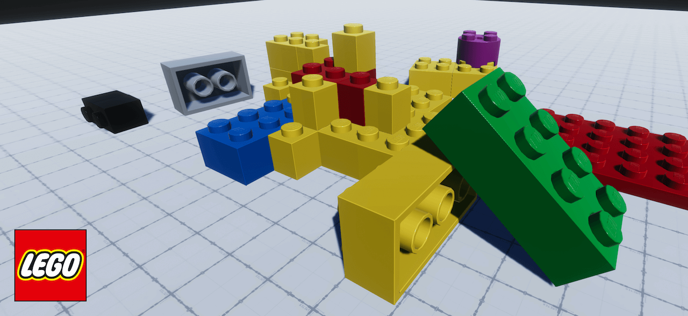
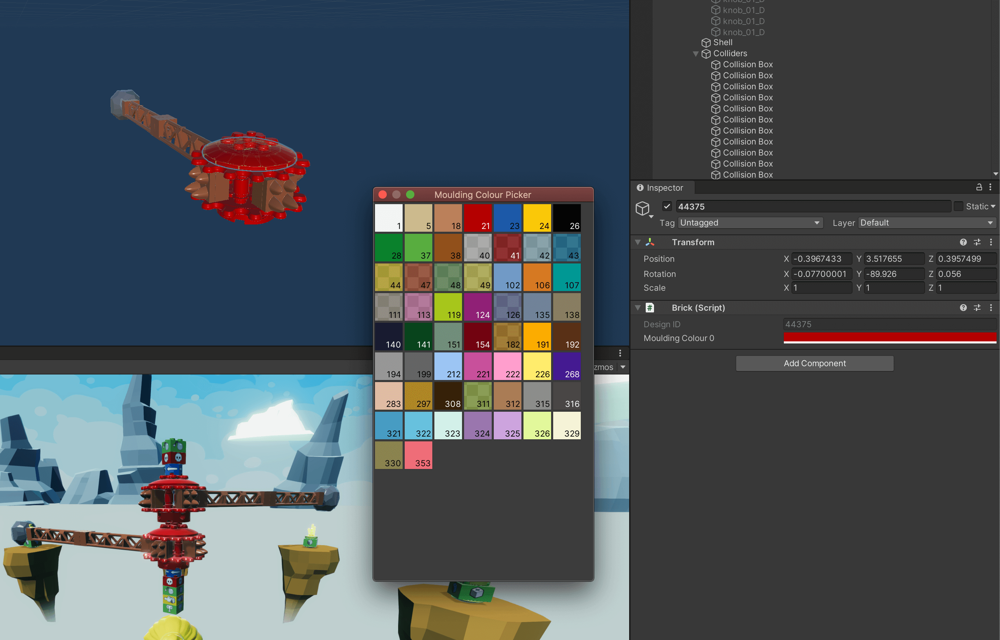

# LEGO Materials 3.0.2

A complete library of all past and current LEGO Materials used in the physical sets.

## BrickLink Studio 2 colour support

Verified with **BrickLink Studio 2.26.10_1**. With the updated LEGO Model Importer and LEGO Materials packages installed, all 226 LDraw colour codes in that Studio palette resolve to Unity materials when importing `.ldr` models. Satin, glitter and speckle finishes are approximations. Glitter and speckle use material settings without individual rendered particles.

## Instructions

For documentation see [Documentation](Documentation~/LEGO%20Materials.md)

The current version requires **Unity 2021.2+**.

The LEGO Materials contains the moulding materials used in LEGO physical sets.

Use this package in combination with LEGO Model Importer to change the material of a brick.

Select a brick from the Hierarchy and in the inspector you will use the Brick component to change the LEGO material as seen in the image below:

## Community and Feedback

For any feedback or bug reports please reach out to LEGO Games.

Email: [LEGOUnityPackages@lego.com](mailto:LEGOUnityPackages@lego.com)

## License & Terms of Agreement

LEGO Companion License (“License”) Software Copyright © 2020 LEGO System A/S

For licensing details see [LICENSE.md](LICENSE.md)

